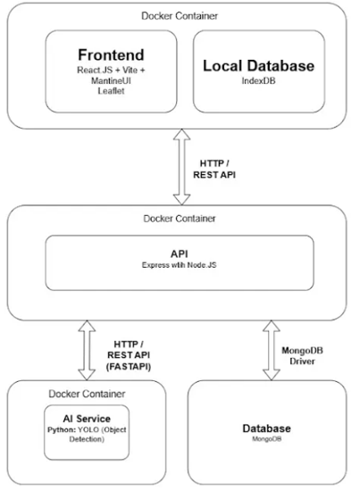

# HuntCredible

**Version 1.0.0 · Team #2**

## Problem Statement
In Arkansas, There has been a decline of licensed hunters recently that results in overpopulation of certain animals species that can lead to negative effects on societal and ecologic environment; increased vehicle collisions due to animals entering human inhabited areas, struggle over food and territory resources that can lead to population decline in non-overpopulated animal species and more.

## Proposed Solution
HuntCredible aims to encourage new users who are unfamiliar or have little experience with hunting to go out and experience hunting in a new way. Through a variety of tools and gamified features, our applications provides new users to make hunting engaging and motivating. 

## Table of Contents

- [Features](#features)
- [Team](#team)
- [Tech Stack](#tech-stack)
- [Architecture](#architecture)
- [Getting Started](#getting-started)
- [Docker Commands](#docker-commands)
- [Troubleshooting](#troubleshooting)
- [Dependency Details](#dependency-details)
- [Product Backlog](#product-backlog)

## Features & User Workflows

- **Accounts and roles:** 
    - Users - Access standard features including account creation and logging in, join parties, begin hunting sessions, use AI model, and participate competitions.   
    - Admin - Access to competition moderation dashboard to review reports of competition submissions that have been reported by other users.
- Hunting Parties: A user can create a party or join one or more parties. Users can start hunting sessions and view party members on a shared map.
- Location Sharing: Members inside of a hunting session share live location and drop shared pins.
- Communication: Party members can message through a group chat.
- Competitions & Challenges: Users can browse competitions and challenges, review rules, and submit entries. Includes community voting and competition rankings.
- Leaderboards: Leaderboard system that ranks users that have top points to be listed.
- Scanning: Users can scan animals out in the wild and be given information about the animal and hunting rules with their photo.


## Team

<table>
  <thead>
    <tr>
      <th>Name</th>
      <th>Technical Role</th>
      <th>Team Responsibility</th>
    </tr>
  </thead>
  <tbody>
    <tr>
      <td>Ryan</td>
      <td>Frontend</td>
      <td>Frontend quality and DevOps</td>
    </tr>
    <tr>
      <td>Devin</td>
      <td>Backend</td>
      <td>Backend technical lead; database and data engineering</td>
    </tr>
    <tr>
      <td>Michael</td>
      <td>AI/ML Engineer</td>
      <td>Product Owner; Scrum Master; AI/ML</td>
    </tr>
  </tbody>
</table>

## Tech Stack
<table>
  <thead>
    <tr>
      <th>Layer</th>
      <th>Technologies</th>
    </tr>
  </thead>
  <tbody>
    <tr>
      <td>Frontend</td>
      <td>React.js, Vite, Mantine UI</td>
    </tr>
    <tr>
      <td>Backend</td>
      <td>Express with Node.js</td>
    </tr>
    <tr>
      <td>Database</td>
      <td>MongoDB Atlas (live), IndexedDB (offline caching)</td>
    </tr>
    <tr>
      <td>AI Service</td>
      <td>Python, FastAPI, Uvicorn, python-multipart, Ultralytics (YOLO), PyTorch, Pillow, exif, pytest</td>
    </tr>
    <tr>
      <td>Maps</td>
      <td>Leaflet</td>
    </tr>
    <tr>
      <td>Containerization</td>
      <td>Docker</td>
    </tr>
    <tr>
      <td>Deployment</td>
      <td>Render</td>
    </tr>
  </tbody>
</table>

## Architecture



## Getting Started

HuntCredible runs entirely in Docker, so you do not need Node.js or Python installed locally.

### Prerequisites

- [Git](https://git-scm.com/install/): to clone the repository
- [Docker Desktop](https://www.docker.com/products/docker-desktop/): to build and run the services

Make sure Docker Desktop is running before you continue.

### 1. Clone the repository

```bash
git clone <https://github.com/md37971/HuntCredible.git>
cd HuntCredible
```

You can also download the ZIP from the repository page and extract it.

### 2. Configure environment variables

The project uses a single environment variable, `MONGODB_URI`, the MongoDB Atlas connection string. Copy the example file:

```bash
# macOS / Linux / Git Bash
cp .env.example .env

# Windows (PowerShell)
Copy-Item .env.example .env
```

Then edit `.env` and add the credentials provided by the team:

```env
MONGODB_URI=mongodb+srv://<username>:<password>@<cluster-address>/<database>
```

> **Security:** never commit `.env` or share real database credentials. Confirm `.env` is listed in `.gitignore`.

### 3. Build and start

```bash
docker compose up --build -V
```

`--build` rebuilds the images and `-V` (`--renew-anon-volumes`) recreates anonymous volumes for a clean start.

> **First run:** the initial build takes several minutes. Docker installs the JavaScript dependencies, and the AI service installs the Python libraries in `ai-service/requirements.txt` (PyTorch and Ultralytics are large). Later starts are much faster.

### 4. Open the app

When the build finishes, open **http://localhost:5173** in your browser.

## Docker Commands

Run these from the project root (where `docker-compose.yml` lives).

<table>
  <thead>
    <tr>
      <th>Task</th>
      <th>Command</th>
    </tr>
  </thead>
  <tbody>
    <tr>
      <td>Start or update containers</td>
      <td><code>docker compose up --build -V</code></td>
    </tr>
    <tr>
      <td>Start in the background</td>
      <td><code>docker compose up -d</code></td>
    </tr>
    <tr>
      <td>Stop and remove containers</td>
      <td><code>docker compose down</code></td>
    </tr>
    <tr>
      <td>Stop containers without removing them</td>
      <td><code>docker compose stop</code></td>
    </tr>
    <tr>
      <td>View running containers</td>
      <td><code>docker compose ps</code></td>
    </tr>
    <tr>
      <td>View logs</td>
      <td><code>docker compose logs</code></td>
    </tr>
    <tr>
      <td>Follow live logs</td>
      <td><code>docker compose logs -f</code></td>
    </tr>
    <tr>
      <td>Follow logs for one service</td>
      <td><code>docker compose logs -f &lt;service-name&gt;</code></td>
    </tr>
  </tbody>
</table>

## Troubleshooting

- **Cannot connect to the Docker daemon:** start Docker Desktop and wait for it to finish loading.
- **Port already in use:** another program is using port 5173. Close it, or run `docker compose down` to stop earlier HuntCredible containers.
- **Database errors on startup:** re-check `MONGODB_URI` in `.env` and confirm your IP address is allowed in MongoDB Atlas network access settings.
- **Changes not showing up:** rebuild with `docker compose up --build -V`.

## Dependency Details

## Components
<table>
  <thead>
    <tr>
      <th>Component</th>
      <th>Technology</th>
      <th>Responsibility</th>
    </tr>
  </thead>
  <tbody>
    <tr>
      <td>Frontend</td>
      <td>React.js, Vite, Mantine UI, Leaflet</td>
      <td>UI, camera and GPS capture, maps, offline caching</td>
    </tr>
    <tr>
      <td>Backend API</td>
      <td>Node.js, Express</td>
      <td>API endpoints, authentication, business logic, database access</td>
    </tr>
    <tr>
      <td>AI Service</td>
      <td>Python, FastAPI, Ultralytics (YOLO), PyTorch</td>
      <td>Animal recognition, image validation, metadata extraction</td>
    </tr>
    <tr>
      <td>Database</td>
      <td>MongoDB Atlas</td>
      <td>Live storage for users, submissions, challenges and parties</td>
    </tr>
  </tbody>
</table>


### Frontend

<table>
  <thead>
    <tr>
      <th>Package</th>
      <th>Purpose</th>
    </tr>
  </thead>
  <tbody>
    <tr>
      <td>React.js</td>
      <td>Builds the user interface</td>
    </tr>
    <tr>
      <td>Vite</td>
      <td>Development server and build tool</td>
    </tr>
    <tr>
      <td>Mantine UI</td>
      <td>Component library</td>
    </tr>
    <tr>
      <td>Leaflet / React-Leaflet</td>
      <td>Interactive maps</td>
    </tr>
  </tbody>
</table>

### Backend

<table>
  <thead>
    <tr>
      <th>Package / Service</th>
      <th>Purpose</th>
    </tr>
  </thead>
  <tbody>
    <tr>
      <td>Express + Node.js</td>
      <td>API service endpoints</td>
    </tr>
    <tr>
      <td>MongoDB Atlas</td>
      <td>Application data storage</td>
    </tr>
    <tr>
      <td>IndexedDB</td>
      <td>Offline caching in the browser</td>
    </tr>
    <tr>
      <td>Multer</td>
      <td>Uploads image to express middleware</td>
    </tr>
    <tr>
      <td>Sharp</td>
      <td>Used for image compressoin</td>
    </tr>
    <tr>
      <td>Axios</td>
      <td>Make HTTP requests for external services</td>
    </tr>
    <tr>
      <td>Bycrypt</td>
      <td>Hashed passwords to protect user credentials</td>
    </tr>
    <tr>
      <td>Express-session</td>
      <td>Manage user sessions and maintains authentication state</td>
    </tr>
  </tbody>
</table>

### AI Service

<table>
  <thead>
    <tr>
      <th>Package</th>
      <th>Purpose</th>
    </tr>
  </thead>
  <tbody>
    <tr>
      <td>FastAPI</td>
      <td>Endpoints for the AI service</td>
    </tr>
    <tr>
      <td>Uvicorn</td>
      <td>Runs the FastAPI application</td>
    </tr>
    <tr>
      <td>python-multipart</td>
      <td>Handles image file uploads</td>
    </tr>
    <tr>
      <td>Ultralytics</td>
      <td>Provides the YOLO model</td>
    </tr>
    <tr>
      <td>PyTorch</td>
      <td>Machine learning framework</td>
    </tr>
    <tr>
      <td>Pillow</td>
      <td>Image loading and validation</td>
    </tr>
    <tr>
      <td>exif</td>
      <td>Image metadata extraction</td>
    </tr>
    <tr>
      <td>pytest</td>
      <td>Automated tests for the Python API endpoints</td>
    </tr>
  </tbody>
</table>

<details>
<summary>Frontend <code>package.json</code></summary>

```json
{
  "name": "client",
  "private": true,
  "version": "0.0.0",
  "type": "module",
  "scripts": {
    "dev": "vite",
    "build": "vite build",
    "lint": "oxlint",
    "preview": "vite preview"
  },
  "dependencies": {
    "@mantine/core": "^9.8.0",
    "@mantine/hooks": "^9.8.0",
    "axios": "^1.21.1",
    "leaflet": "^1.9.4",
    "react": "^19.3.1",
    "react-dom": "^19.3.1",
    "react-leaflet": "^5.0.0",
    "react-router": "^8.5.1"
  },
  "devDependencies": {
    "@types/node": "^24.19.2",
    "@types/react": "^19.3.0",
    "@types/react-dom": "^19.3.0",
    "@vitejs/plugin-react": "^6.1.2",
    "oxlint": "^1.90.0",
    "postcss": "^8.5.32",
    "postcss-preset-mantine": "^1.18.0",
    "postcss-simple-vars": "^7.0.1",
    "typescript": "~7.0.2",
    "vite": "^8.3.6"
  }
}
```

</details>

<details>
<summary>Backend <code>package.json</code></summary>

```json
{
  "name": "backend",
  "version": "1.0.0",
  "description": "",
  "main": "index.js",
  "type": "module",
  "scripts": {
    "start": "node index.js",
    "dev": "nodemon --legacy-watch index.js"
  },
  "keywords": [],
  "dependencies": {
    "axios": "^1.21.1",
    "bcrypt": "^6.0.0",
    "dotenv": "^18.0.10",
    "express": "^5.3.0",
    "express-session": "^1.19.0",
    "mongodb": "^7.8.0",
    "multer": "^2.5.0",
    "sharp": "^0.35.5"
  },
  "devDependencies": {
    "nodemon": "^3.1.14"
  }
}
```
</details>

AI service <code>requirements.txt</code>

```text
fastapi
uvicorn
python-multipart
ultralytics
pillow
exif
pytest
```

</details>

## Product Backlog

<table>
  <thead>
    <tr>
      <th>Feature</th>
      <th>Priority</th>
    </tr>
  </thead>
  <tbody>
    <tr>
      <td>Account creation and login for competitions, the party system and stored user data</td>
      <td>High</td>
    </tr>
    <tr>
      <td>AI/ML animal recognition on photo submission, with animal information and hunting guidelines</td>
      <td>High</td>
    </tr>
    <tr>
      <td>GPS and camera access so photos upload with metadata and user location is tracked</td>
      <td>High</td>
    </tr>
    <tr>
      <td>Party system with chat and geolocation</td>
      <td>High</td>
    </tr>
    <tr>
      <td><code>User</code> and <code>Admin</code> roles (admins can add/remove accounts and access the database)</td>
      <td>High</td>
    </tr>
    <tr>
      <td>Leaderboard showing the users with the highest points</td>
      <td>Medium</td>
    </tr>
    <tr>
      <td>Anti-cheat: checks on metadata, duplicate imagery and fraudulent imagery</td>
      <td>Medium</td>
    </tr>
    <tr>
      <td>Built-in gallery where photos can only be uploaded through the in-app camera</td>
      <td>Medium</td>
    </tr>
    <tr>
      <td>Public-safe photo metadata (such as where the image was taken) shown with camera photos</td>
      <td>Medium</td>
    </tr>
  </tbody>
</table>